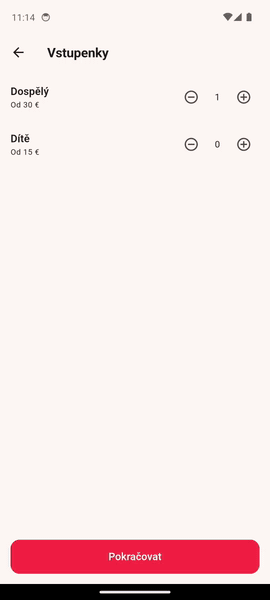

# Maestro Booking Demo

A Flutter demo app for a booking/checkout flow (tickets → date/time → questions → payment → success).

## Prerequisites

- [Flutter SDK](https://docs.flutter.dev/get-started/install) (channel: stable). Verify with:
  ```
  flutter doctor
  ```

### Android (emulator or physical device) — required for Maestro tests

Maestro drives the app through its native Android/iOS accessibility tree, so an
Android emulator or physical device is the supported way to run this project.

Needs the Android SDK installed (via whichever IDE/tooling you prefer — Android Studio, VS Code with the Flutter extension, or the command-line tools), plus either a running emulator (`flutter emulators --launch <id>`) or a physical device connected with USB debugging enabled.

```bash
flutter pub get
flutter devices        # confirm your emulator/device shows up
flutter run             # picks the first available device
```

`flutter doctor` will tell you exactly what's missing — follow its instructions if something is red/yellow.

### Web / Chrome — quick manual preview only

```bash
flutter pub get
flutter run -d chrome
```

Useful for eyeballing the UI quickly, but **not** a target for the Maestro
flow — Maestro cannot drive a web build, only a native Android/iOS one.

## Project structure

```
lib/
  main.dart              # app entry point, theming
  models/                # app/booking state
  screens/                # each step of the booking flow
  widgets/                # shared UI pieces
  utils/, ids/, l10n/     # helpers, id generation, strings
```

## Tests

```bash
flutter test
```

## Maestro end-to-end tests

Seven flows in `test/maestro/`; the steps they share live in
`test/maestro/helpers/` and are never run on their own.
Run results (repeated runs on two devices) and a requirement-by-requirement
coverage table are in [TEST_REPORT.md](TEST_REPORT.md); issues found while
exploring the app are in [FINDINGS.md](FINDINGS.md).



*`purchase_flow` on the Android 14 emulator, 6× speed: tickets → dates →
questions → checkout → declined card → promo code → Success.*

### Run

```bash
# Maestro CLI, if you don't have it yet
curl -fsSL "https://get.maestro.mobile.dev" | bash

# build and install the app on a connected Android device or emulator
flutter build apk --release
adb install -r build/app/outputs/flutter-apk/app-release.apk

maestro test test/maestro/                     # all seven flows (Czech UI)
maestro test -e APP_LANG=en test/maestro/      # the same in English
maestro test test/maestro/purchase_flow.yaml   # only the main purchase
maestro test test/maestro/known_issues/        # findings as tests - fail today
./run_tests.sh 5                               # whole suite 5x in a row,
                                               # JUnit + screenshots in reports/
DEVICE=emulator-5554 ./run_tests.sh 5          # pick a device when several are connected
# OnePlus / OxygenOS: add -e CLEAR_STATE=false (see known limitations)
```

Tested with app 1.0.0+1 (branch `feat-creat-app-init`, commit `e5bf530`),
release build, Flutter 3.47.9, Maestro 2.12.1, on:

- Android emulator, Pixel 7 profile, Android 14 (`google_apis` arm64 image)
- OnePlus 7T Pro, Android 12 (OxygenOS)

iOS was not tested.

### Flows

| Flow | What it checks |
| --- | --- |
| `purchase_flow` | The full purchase with a random Adult/Child mix. On the way: a child alone is blocked; only the first product is unlocked at the start; Continue is blocked until the required dates are set; **Reset selection** really clears confirmed dates; an empty Questions form is blocked; only required fields are filled; an empty Checkout shows its errors; an empty and a too-short card form are rejected; the total on Checkout matches the computed price; the declined card payment is recovered with the promo code. On Success: ticket counts, the three booked products with date and time, the optional product absent, per-type price lines, the 10 % fee, original price, discount and 0.00 due. |
| `promo_code_rules` | An unknown code gives no discount; the valid code works in lower case; removing it restores the full price. |
| `datetime_dependencies` | Hop-on Hop-off is locked until Madame Tussauds has a time; its slots start two hours later (14:00 → first slot 16:00); re-confirming Madame clears Hop-on; a new date for the first product clears every other product and blocks Continue again. |
| `timeslots_closed` | No slots left for the day: the dialog says so, nothing is confirmed, Continue stays blocked. |
| `max_tickets_cap` | 20 tickets combined; further taps on + are ignored. |
| `child_without_adult` | Removing the adult after adding a child brings the error back and blocks Continue; minus stops at zero; adding the adult back unblocks. |
| `double_tap_continue` | Two quick taps on Continue during the 3–8 s loading still open exactly one Date & time page. |

### How it stays stable

- Every Continue / Pay / Confirm shows a loading overlay for a random 3–8 s.
  `helpers/continue_and_wait.yaml` waits for the **next page id** instead of
  sleeping, so the test is as fast as the app and never races it.
- Selectors are semantic ids. The only text match is one dropdown option
  (see Findings).
- Pages are lazy `ListView`s, so items are scrolled into view
  (`scrollUntilVisible`) before they are tapped or asserted. Scrolling stops
  at 50 % visibility: with the release build, a 100 % check kept swiping past
  the last product's button although it was fully on screen — most likely the
  Android 12+ overscroll "stretch" distorting bounds at the end of the list.
- Taps use `retryTapIfNoChange: false`. By default Maestro taps again when it
  thinks nothing changed; on the OnePlus the view hierarchy sometimes updated
  late, and a silent second tap on a + button or a checkbox would change the
  order. Instead, every tap is followed by an explicit assertion.
- The expected prices are computed in `helpers/random_tickets.js` from the
  random quantities (30 € adult, 15 € child, +10 % fee) and asserted on
  Checkout and Success, so a random mix is still fully checked.
- Flutter gives focus back to the last text field when a page reappears, and
  the first Android back press then only closes the keyboard.
  `helpers/back_until_gone.yaml` presses back until the page is really gone.
- **Both languages.** The app starts in Czech; with `-e APP_LANG=en`,
  `helpers/fresh_launch.yaml` switches it to English and every flow runs the
  same. `helpers/strings.js` holds the expected texts per language, and the
  flows check them where a wrong language would hurt a customer: the
  child-needs-adult error, the required-field error, Continue, the closed
  slots message, "Payment declined", "Confirm order" and the thank-you on
  Success. Strings the findings call wrong are deliberately not asserted.
- Same-day time slots close after 15:00. The app has test-only tap targets
  (`Debug_SetForceOpenButton` / `Debug_SetForceClosedButton`) that make this
  deterministic; flows that need slots force them open, `timeslots_closed`
  forces them closed.

### Findings

Exploring the app turned up 28 issues — full list with severity and where
they are in the code: [FINDINGS.md](FINDINGS.md). The ones a customer would
feel most:

- Same-day time slots follow the **phone's clock and time zone**, not New
  York's, and the 15:00 cutoff both **sells slots that already passed** and
  closes ones still ahead.
- **Checkout has no e-mail field** — nowhere to send the tickets.
- The **10 % booking fee is never shown before paying**; it first appears on
  Success.
- **Card payment is always declined** in this build; `purchase_flow` reaches
  Success through the promo code, the way a customer would discover it.

One testability gap: the "How did you hear about us?" dropdown options have
no ids, so the suite matches that option's visible label in each language
(fix suggested in FINDINGS.md).

### Findings as tests

`test/maestro/known_issues/` holds one flow per automatable finding (9 of
them). Each asserts the behaviour a customer would **expect**, so it fails
today and turns green once the issue is fixed — an executable bug report.
Maestro only runs the top level of `test/maestro/`, so the main suite stays
green.

### Assumptions and known limitations

- Random quantities are 1–4 adults and 0–3 children. Each ticket adds a
  required checkbox on Questions, so bigger numbers mostly add runtime; the
  20 limit has its own flow.
- Test data is ASCII only: on **OnePlus / OxygenOS** Maestro can't type
  non-ASCII text (`WRITE_SECURE_SETTINGS`) unless Developer options →
  *Disable permission monitoring* is on.
- The same OxygenOS restriction can block `clearState` (`pm clear` →
  `SecurityException`). `helpers/fresh_launch.yaml` therefore lets you skip
  it with `-e CLEAR_STATE=false`; the app keeps all state in memory, so a
  killed and relaunched app is still a clean start. The OnePlus runs in
  TEST_REPORT.md used this switch; the emulator runs use real `clearState`.
- On the OnePlus the same suite takes about twice as long as on the emulator:
  Maestro regularly waited 15–30 s for the view hierarchy to settle, and the
  waits always ended at the same seconds of the minute, i.e. on unrelated
  status-bar updates. The flows themselves pass the same on both devices.

### What I would automate next

- A fixed 1-adult variant of `purchase_flow` as a fast CI smoke test, keeping
  the random one for a nightly run.
- The rest of the Hop-on Hop-off window (only the two-hour rule from 14:00
  is checked).
- A CI job (e.g. GitHub Actions) running the suite on an Android emulator in
  both languages on every push and publishing the JUnit report —
  `run_tests.sh` already takes the device and language as parameters.
- An iOS run.
